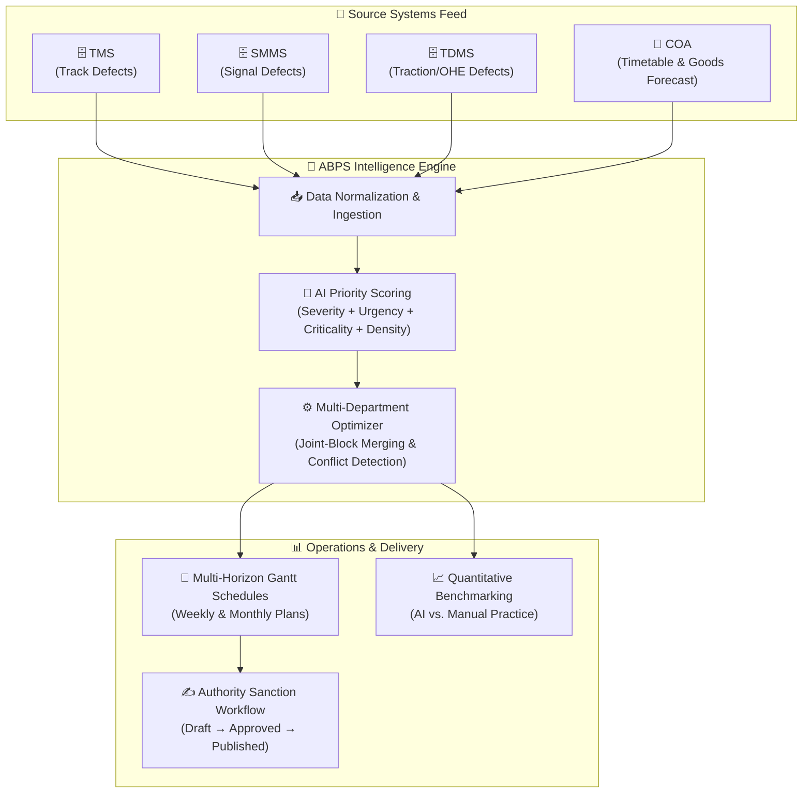

<div align="center">

# 🚆 Automatic Block Planning System (ABPS)
### **AI-Powered Multi-Department Maintenance Scheduling & Corridor Coordination**
*Ministry of Railways — Problem Statement 26027*

[](https://fastapi.tiangolo.com)
[](https://streamlit.io)
[](https://www.python.org/)
[](https://sqlite.org/)
[](https://plotly.com/)
[](https://opensource.org/licenses/MIT)

<br/>

> **"Transforming decentralized, manual railway block planning into an intelligent, data-driven, coordinated process that maximizes fixed infrastructure uptime, eliminates redundant track closures, and protects train punctuality."**

</div>

---

## 📌 Executive Summary & Context

In **Indian Railways**, maintenance of fixed track infrastructure is executed across three independent departments:
- 🛠️ **Engineering (Civil/Track):** Rails, sleepers, turnouts, bridges (tracked via **TMS**).
- 🟢 **Signal & Telecommunication (S&T):** Track circuits, signals, points, cables (tracked via **SMMS**).
- ⚡ **Traction Distribution (TRD):** Overhead Electric lines (OHE), power feeds (tracked via **TDMS**).

### 🛑 The Core Problem
Under existing standard operating procedures, each department requests track closures and power cut-offs (**"Blocks"**) independently through the **BDMS** portal. 

Because planning happens in silos:
- Track Department blocks a section in the morning.
- S&T blocks the **same section** in the afternoon.
- Duplicate blocks occur, train paths are disrupted, passenger delay minutes surge, and corridor asset availability plummets.

### 💡 The ABPS Solution
**ABPS** integrates defect data from **TMS**, **SMMS**, and **TDMS** with live train timetable gaps from the **Control Office Application (COA)**. Using an AI-driven constraint optimizer, it produces **Joint Coordinated Blocks** — enabling multiple departments to perform maintenance safely inside the same block window, drastically cutting down track downtime.

---

## 🏗️ System Architecture



---

## ✨ Key Features & Capabilities

### 1. 🎯 Mathematical AI Priority Scoring
Every defect is automatically scored (0 to 100) using a multi-factor weighting formula specified in the Software Requirements Specification:
$$\text{Score} = w_1 \cdot \text{Severity} + w_2 \cdot \text{Urgency (Overdue Days)} + w_3 \cdot \text{AssetCriticality} + w_4 \cdot \text{TrafficDensity}$$
- **Must-Schedule Safety Flag:** Safety-critical defects (e.g. rail fractures, signal lamp failures) are automatically pinned and can never be silently dropped by the optimizer.
- **Explainability:** Transparent factor breakdown showing exact points contributed by each variable.

### 2. ⚙️ Joint-Block Optimization Engine
- Analyzes timetable gaps to identify legal work windows without halting high-priority express trains.
- Merges compatible tasks (e.g. S&T cable repair + Track inspection) into **one single block**.
- Enforces hard safety compatibility constraints (e.g., heavy track tamping machines vs. overhead OHE maintenance cannot overlap unsafely).

### 3. 📅 Multi-Horizon Advisory Planning
- **Weekly Horizon (7 Days):** Exact hour-by-hour windows with assigned maintenance crews.
- **Monthly Horizon (30 Days):** Strategic planning to eliminate overdue defect backlogs across sections.

### 4. 🎨 Modern Indian Railways Dashboard
- Designed with official Indian Railways navy & gold aesthetics.
- Visual **Gantt charts** color-coded by department:
  - 🔵 **Blue:** Engineering (Civil / Track)
  - 🟢 **Green:** Signal & Telecom (S&T)
  - 🟠 **Orange:** Traction Distribution (TRD)
  - 🟣 **Purple:** Coordinated Joint Blocks

### 5. 🔬 Scientific Benchmarking Simulation
- Real-time side-by-side execution: **ABPS AI Optimizer vs. Conventional Manual Silos**.
- Proves measurable gains: **+% tasks scheduled**, **blocks saved**, and **-% train delay minutes**.

### 6. 🛡️ Role-Based Access Control (RBAC) & Audit Trail
- Separate views and permissions for **Department Planners**, **Section Controllers**, and **Sr. Divisional Engineers (Approvers)**.
- Immutable chronological audit trail recording every change, generation, and approval.

---

## 🚀 Quick Start Guide

### Prerequisites
- Python 3.10 or higher
- Git

### 1. Clone the Repository
```bash
git clone https://github.com/Kr1sh8/ABPS-railway.git
cd ABPS-railway
```

### 2. Install Dependencies
```bash
pip install -r requirements.txt
```

### 3. Seed Database with Synthetic Corridor Data
```bash
python backend/init_db.py
```
*Populates 15 core railway corridors, 200+ multi-department tasks, and 1,600+ block windows.*

### 4. Run the System

**Option A — Automated Launcher (Windows):**
Simply double-click:
```cmd
start.bat
```

**Option B — Manual Terminal Execution:**
- **Terminal 1 (Backend API):**
  ```bash
  uvicorn backend.main:app --port 8000
  ```
- **Terminal 2 (Frontend Dashboard):**
  ```bash
  streamlit run frontend/app.py
  ```

Access the interfaces:
- 🖥️ **Web Dashboard:** [http://localhost:8501](http://localhost:8501)
- 📖 **Interactive Swagger API Docs:** [http://localhost:8000/docs](http://localhost:8000/docs)

---

## 🔑 Default Credentials for Evaluation

| User ID | Password | Department / Role | System Access |
|---|---|---|---|
| `admin` | `admin123` | System Administrator | Full administrative rights & user management |
| `planner1` | `plan123` | Engineering (Track) | TMS Task Planner |
| `planner2` | `plan123` | Signal & Telecom | SMMS Task Planner |
| `planner3` | `plan123` | Traction Distribution | TDMS Task Planner |
| `approver` | `approve123` | Sr. DEN / Sanctioning Authority | Authority to review, approve, or reject plans |
| `viewer` | `view123` | Operations Viewer | Read-only inspection mode |

---

## 📂 Project Structure

```
ABPS-railway/
├── backend/
│   ├── auth.py          # Secure JWT authentication & SHA-256 salted hashing
│   ├── database.py      # SQLAlchemy connection & session manager
│   ├── init_db.py       # Corridor, task, and timetable generator
│   ├── main.py          # FastAPI REST endpoints
│   ├── models.py        # Relational schema (Sections, Tasks, Windows, Plans)
│   ├── optimizer.py     # Joint block scheduling algorithm & baseline comparator
│   ├── schemas.py       # Pydantic validation models
│   └── scoring.py       # Mathematical priority scoring formula
├── frontend/
│   └── app.py           # Streamlit Indian Railways Executive Portal
├── requirements.txt     # Python package dependencies
├── start.bat            # Windows 1-click startup automation
├── stop.bat             # Clean shutdown script
└── README.md            # Project documentation
```

---

## 👥 Development Team

* **Krish Desai** — *Backend Architecture, Constraint Optimization & API Services*
* **Krish Mittal** — *Data Modelling, AI Scoring Engine & Benchmarking*
* **Krishna Rathore** — *Frontend UI/UX, Gantt Visualizations & Documentation*

---

<div align="center">
<sub>Developed for the Ministry of Railways • Problem Statement 26027</sub>
</div>
