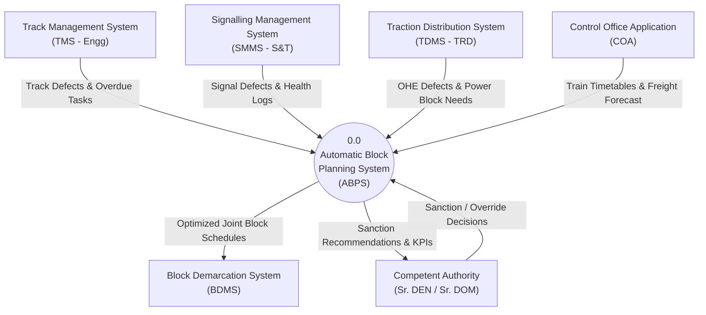
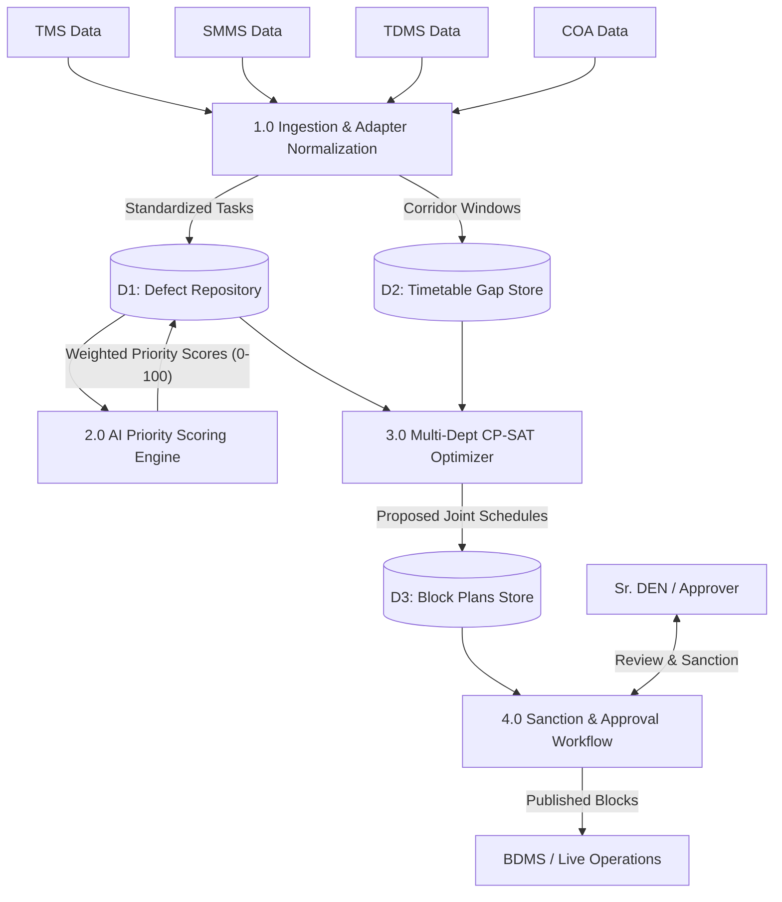
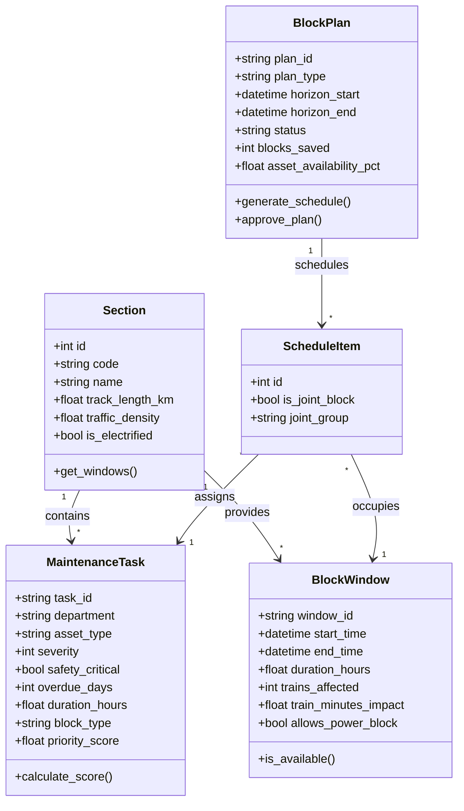
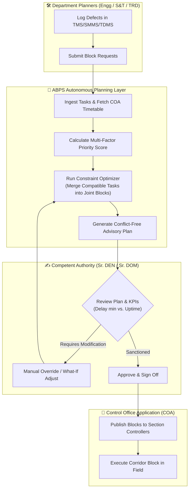
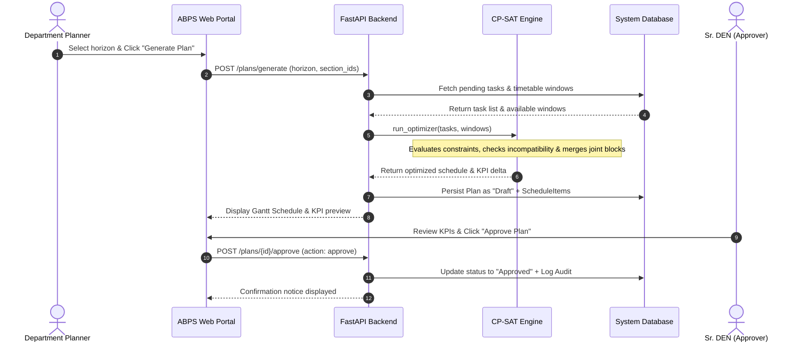
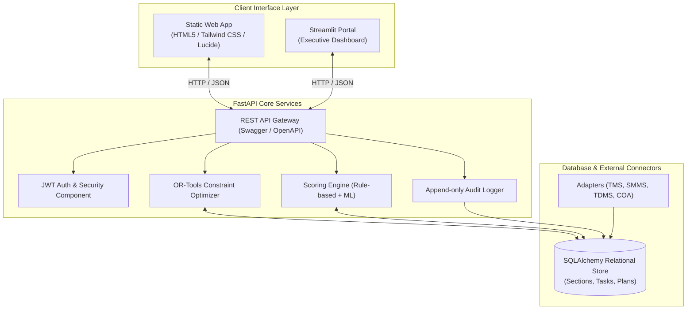
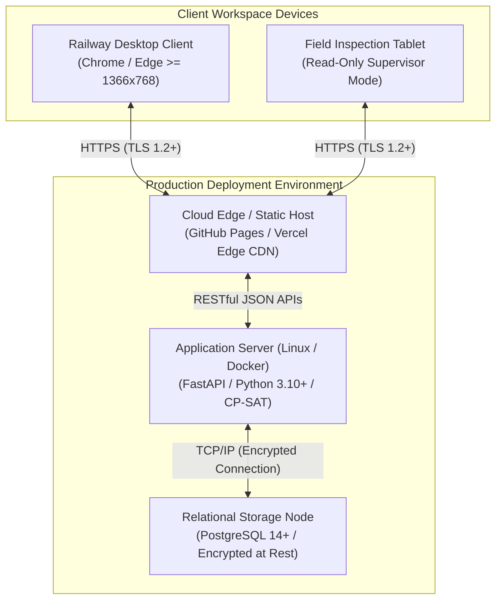

<div align="center">

# 🚆 Automatic Block Planning System (ABPS)
### **AI-Powered Multi-Department Maintenance Scheduling & Corridor Coordination**
*Ministry of Railways — Problem Statement 26027*

[](https://kr1sh8.github.io/ABPS-railway/)
[](https://github.com/Kr1sh8/ABPS-railway)
[](https://fastapi.tiangolo.com)
[](https://streamlit.io)
[](https://www.python.org/)
[](https://opensource.org/licenses/MIT)

<br/>

> **"Transforming decentralized, manual railway block planning into an intelligent, data-driven, coordinated process that maximizes fixed infrastructure uptime, eliminates redundant track closures, and protects train punctuality."**

<br/>

### 🌐 [👉 Click Here to Open Live Deployed Web Application](https://kr1sh8.github.io/ABPS-railway/)
**Live Portal URL:** `https://kr1sh8.github.io/ABPS-railway/`  
**Demo Credentials:** Username: `admin` | Password: `admin123`

</div>

---

## 📌 Executive Summary & Context

In **Indian Railways**, maintenance of fixed track infrastructure is executed across three independent departments:
- 🛠️ **Engineering (Civil/Track):** Rails, sleepers, turnouts, bridges (tracked via **TMS**).
- 🟢 **Signal & Telecommunication (S&T):** Track circuits, signals, points, cables (tracked via **SMMS**).
- ⚡ **Traction Distribution (TRD):** Overhead Electric lines (OHE), power feeds (tracked via **TDMS**).

### 🛑 The Core Problem
Under existing standard operating procedures, each department requests track closures and power cut-offs (**"Blocks"**) independently through the **BDMS** portal. 

Because planning happens in silos:
- Track Department blocks a section in the morning.
- S&T blocks the **same section** in the afternoon.
- Duplicate blocks occur, train paths are disrupted, passenger delay minutes surge, and corridor asset availability plummets.

### 💡 The ABPS Solution
**ABPS** integrates defect data from **TMS**, **SMMS**, and **TDMS** with live train timetable gaps from the **Control Office Application (COA)**. Using an AI-driven constraint optimizer, it produces **Joint Coordinated Blocks** — enabling multiple departments to perform maintenance safely inside the same block window, drastically cutting down track downtime.

---

## 📐 Software Engineering Laboratory Design Models & Architecture
*Conforming to CS3CO40(P) Software Engineering Lab Curriculum (Student: Krish Desai | Enrolment: EN24CS3010550)*

---

### 🔹 Experiment 3: Function-Oriented Diagrams — Data Flow Diagrams (DFD)

#### Level 0 DFD (Context Diagram)
The Context Diagram represents the overall boundaries of ABPS, showing external interacting entities and high-level data flows.



#### Level 1 DFD (Decomposed Functional Modules)
Decomposes the core processes into Ingestion, AI Scoring, Constraint Optimization, and Decision Review.



---

### 🔹 Experiment 4: User's View Analysis — Use Case Diagram

Illustrates functional interactions between the different primary actors in Indian Railways and ABPS.

```mermaid
flowchart LR
    subgraph Actors
        P1["Track Planner\n(Engineering)"]
        P2["Signal Planner\n(S&T)"]
        P3["Traction Planner\n(TRD)"]
        CO["Section Controller\n(COA)"]
        AP["Sr. DEN / Approver\n(Sanctioning Authority)"]
    end

    subgraph ABPS_System ["Automatic Block Planning System (ABPS)"]
        UC1(["UC-1: Ingest Maintenance Defects"])
        UC2(["UC-2: View AI Priority Telemetry"])
        UC3(["UC-3: Run Optimization & Joint Merging"])
        UC4(["UC-4: Review Corridor Window Timeline"])
        UC5(["UC-5: Manual Block Override / What-If"])
        UC6(["UC-6: Sanction & Publish Block Plan"])
        UC7(["UC-7: Audit Trail & Benchmark Analytics"])
    end

    P1 --> UC1
    P1 --> UC2
    P2 --> UC1
    P2 --> UC2
    P3 --> UC1
    P3 --> UC2

    CO --> UC4
    CO --> UC3

    AP --> UC3
    AP --> UC5
    AP --> UC6
    AP --> UC7
```



---

### 🔹 Experiment 5: Structural View Diagrams

#### Class Diagram
Entity relationship and object-oriented class structure for database and computational models.



---

### 🔹 Experiment 6: Behavioral View — Swimlane Diagram (Multi-Department Process Flow)

Tracks the workflow across organizational roles from defect generation to train controller execution.



---

### 🔹 Experiment 7: Behavioral View — Sequence Diagram

Chronological message sequence for generating and approving an optimized block plan.



---

### 🔹 Experiment 8: Implementation View — Component Diagram

Architecture components and interface boundaries.



---

### 🔹 Experiment 9: Environmental View — Deployment Diagram

Physical deployment topology for railway computing environments.



---

## 🚀 Quick Start & Local Execution

### 1. Clone Repository
```bash
git clone https://github.com/Kr1sh8/ABPS-railway.git
cd ABPS-railway
```

### 2. Install Dependencies
```bash
pip install -r requirements.txt
```

### 3. Seed Database
```bash
python backend/init_db.py
```

### 4. 1-Click Launch (Windows)
Double click:
```cmd
start.bat
```
- **Web Dashboard:** [http://localhost:8501](http://localhost:8501)
- **API Documentation:** [http://localhost:8000/docs](http://localhost:8000/docs)
- **Static Web App:** Open `index.html` directly in any browser!

---

## 👥 Project Team

* **Krish Desai** *(Enrolment: EN24CS3010550)* — *Backend Architecture, Constraint Optimization & API Services*
* **Krish Mittal** — *Data Modelling, AI Scoring Engine & Benchmarking*
* **Krishna Rathore** — *Frontend UI/UX, Gantt Visualizations & Documentation*

---

<div align="center">
<sub>Department of Computer Science & Engineering • CS3CO40(P) Software Engineering Laboratory</sub>
</div>
